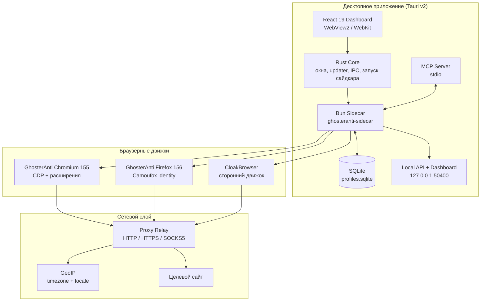
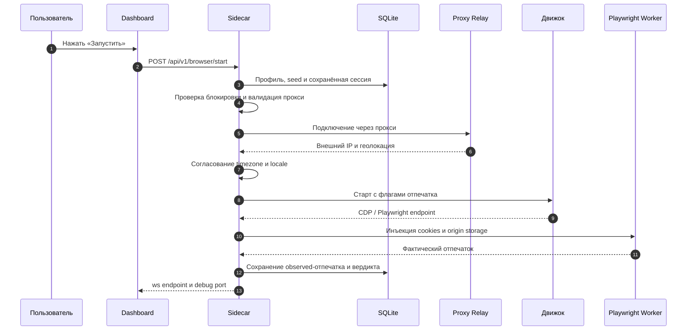
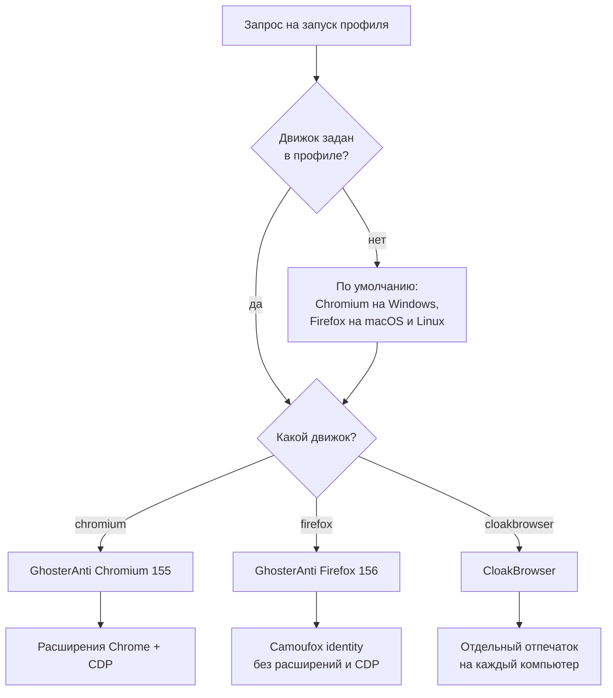
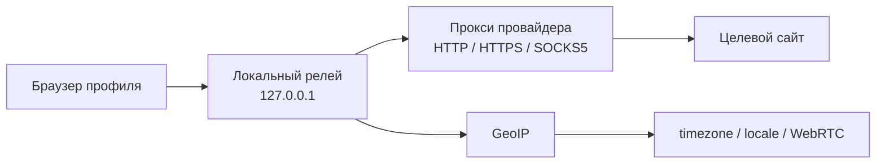

# GhosterAnti (v0.1.0-beta.65)

<div align="center">


### Антидетект-браузер и локальный менеджер профилей: отдельная цифровая личность для каждого аккаунта

*Три движка браузера • Детерминированные отпечатки с аттестацией • Свои прокси, часовые пояса и локали • Local API и MCP-сервер • Полностью локально, открыто и бесплатно*

</div>

---

## Оглавление

1. [Архитектура и ключевые возможности](#1-архитектура-и-ключевые-возможности)
2. [Интерактивные диаграммы работы системы](#2-интерактивные-диаграммы-работы-системы)
   - [Общая архитектура GhosterAnti](#21-общая-архитектура-ghosteranti)
   - [Жизненный цикл запуска профиля](#22-жизненный-цикл-запуска-профиля)
   - [Выбор движка браузера](#23-выбор-движка-браузера)
   - [Сетевой слой и прокси-релей](#24-сетевой-слой-и-прокси-релей)
3. [Как работает запуск профиля](#3-как-работает-запуск-профиля)
4. [Браузерные движки](#4-браузерные-движки)
5. [Fingerprint-движок и аттестация](#5-fingerprint-движок-и-аттестация)
6. [Прокси и сетевой слой](#6-прокси-и-сетевой-слой)
7. [Local API, совместимый с AdsPower](#7-local-api-совместимый-с-adspower)
8. [MCP-сервер и автоматизация ИИ-агентов](#8-mcp-сервер-и-автоматизация-ии-агентов)
9. [Профили, массовые операции и данные](#9-профили-массовые-операции-и-данные)
10. [Скрипты, расширения и корзина](#10-скрипты-расширения-и-корзина)
11. [Облачная синхронизация](#11-облачная-синхронизация)
12. [Структура файлов и папок](#12-структура-файлов-и-папок)
13. [Конфигурация и запуск](#13-конфигурация-и-запуск)
14. [Руководство по решению проблем (Troubleshooting)](#14-руководство-по-решению-проблем-troubleshooting)

---

## 1. Архитектура и ключевые возможности

**GhosterAnti (v0.1.0-beta.65)** — десктопное приложение для Windows x64, macOS arm64 и Linux x64 на гибридном ядре **Rust (Tauri v2)** с интерфейсом на **React 19** и локальным рантаймом на **Bun/TypeScript**. Программа управляет парком изолированных браузерных профилей: каждый профиль — законченная цифровая личность со своим движком, отпечатком, прокси, часовым поясом, локалью и сессией.

Приложение не отправляет данные на сторонние серверы: в локальном режиме весь трафик идёт только между дашбордом, локальным API и выбранным прокси.

### Основные функции приложения:

- **Полная изоляция профиля**: cookies, `localStorage`, `IndexedDB`, кэш, история, расширения и отпечаток хранятся в отдельном каталоге. Профили не пересекаются ни по данным, ни по идентичности, а параллельные запуски блокируются на уровне блокировки профиля.
- **Три браузерных движка**: **GhosterAnti Chromium 155**, **GhosterAnti Firefox 156 (Camoufox)** и **CloakBrowser**. Движок выбирается на уровне профиля и не меняется при запуске.
- **Детерминированный fingerprint**: seed генерируется один раз при создании профиля и сохраняется в SQLite. Отпечаток не «плывёт» между запусками и не пересчитывается при старте.
- **Аттестация отпечатка (Fingerprint Attestation)**: после запуска приложение измеряет фактические параметры браузера — User-Agent, Client Hints, WebGL, Canvas, Audio, экран, языки, WebRTC — и сравнивает их с ожидаемыми, показывая вердикт по каждому полю.
- **Прокси и GeoIP**: HTTP, HTTPS и SOCKS5 с авторизацией; встроенный релей, проверка внешнего IP и автоматическое согласование часового пояса и локали с географией прокси.
- **Local API формата AdsPower**: те же маршруты и тот же JSON-конверт, что у AdsPower Local API, поэтому существующие клиенты и SDK работают без изменений. Сервер слушает только `127.0.0.1`.
- **MCP-сервер для ИИ-агентов**: 10 инструментов управления профилями и браузерами плюс полный набор из 31 инструмента Playwright MCP — агент сам создаёт профиль, открывает браузер, работает на странице и корректно закрывает сессию.
- **Массовый импорт профилей**: экспорты **AdsPower, GoLogin, Multilogin, Donut** и других менеджеров в форматах **TXT, CSV, JSON, XLSX**. Файлы можно перетащить в окно или просто положить в папку `inbox/`.
- **Скрипты Playwright**: JavaScript и Python-скрипты, которые выполняются на одном или нескольких профилях одновременно, с журналом запусков и результатом по каждому профилю.
- **Расширения Chrome**: реестр распакованных расширений и назначение их на профили Chromium и CloakBrowser.
- **Портативные профили и перенос сессий**: выгрузка и загрузка cookies вместе с origin storage (`localStorage`/`IndexedDB`), включая сценарии переноса между компьютерами.
- **2FA и автозаполнение**: хранение TOTP-секрета с живым кодом в карточке профиля и автозаполнение логина и пароля на странице входа.
- **Корзина**: удаление профилей с возможностью восстановления, без безвозвратной потери данных.
- **Свой Cloud (опционально)**: синхронизация профилей между устройствами и рабочими пространствами через собственный экземпляр бэкенда.

---

## 2. Интерактивные диаграммы работы системы

### 2.1. Общая архитектура GhosterAnti



### 2.2. Жизненный цикл запуска профиля



### 2.3. Выбор движка браузера



### 2.4. Сетевой слой и прокси-релей



---

## 3. Как работает запуск профиля

Запуск — детерминированный процесс: идентичность профиля фиксируется при создании и читается при каждом старте без пересчёта.

1. **Чтение профиля.** Сайдкар загружает запись из SQLite: движок, seed, User-Agent, экран, часовой пояс, локаль, прокси, cookies, расширения и теги.
2. **Проверка состояния.** Профиль не может быть запущен дважды: блокировка снимается только после корректного закрытия браузера. Если сохранённый прокси больше не валиден, профиль помечается как карантинный и не запускается до замены прокси.
3. **Сетевой слой.** Приложение поднимает локальный релей к прокси, проверяет внешний IP и определяет географию выхода.
4. **Согласование окружения.** По геолокации прокси выбираются часовой пояс и локаль, чтобы они не противоречили IP-адресу.
5. **Подготовка движка.** Нужный движок проверяется по SHA-256 (архив и исполняемый файл). При первом использовании он скачивается из закреплённого релиза.
6. **Запуск браузера.** Движок стартует с флагами отпечатка, отдельным каталогом данных, окном профиля и отладочным портом.
7. **Инъекция сессии.** В браузер добавляются cookies и origin storage; недостающие записи дописываются, существующие не затираются.
8. **Аттестация.** Playwright-worker измеряет фактические параметры и сохраняет их вместе с вердиктом сравнения с ожидаемым отпечатком.
9. **Выдача эндпоинта.** Dashboard и Local API получают `ws`-эндпоинт Playwright и `debug_port` для подключения автоматизации.

> Идентичность профиля неизменяема на уровне запуска: приложение никогда не ротирует User-Agent, seed или разрешение экрана самостоятельно. Любое изменение — только явное действие пользователя в карточке профиля.

---

## 4. Браузерные движки

| Движок | Версия | Основа | Сильные стороны |
| :--- | :--- | :--- | :--- |
| **GhosterAnti Chromium** | 155.0.8059.85 | Chromium | Расширения Chrome, CDP, Playwright, максимальная совместимость |
| **GhosterAnti Firefox** | 156.0.1-beta.36 | Camoufox | Глубокий антидетект-отпечаток, отдельная модель идентичности |
| **CloakBrowser** | 145.0.7632.109.2 (macOS) | Chromium | Альтернативный движок для существующих профилей |

### Поддержка платформ:

| Платформа | Chromium 155 | Firefox 156 | CloakBrowser |
| :--- | :---: | :---: | :---: |
| **Windows x64** | ✅ | ✅ | ✅ |
| **macOS arm64** | ✅ | ✅ | ✅ |
| **Linux x64** | ✅ | ✅ | ❌ |

### Проверка целостности

Каждый движок скачивается из закреплённого релиза и проверяется дважды: по SHA-256 архива и по SHA-256 исполняемого файла после распаковки. Несовпадение хеша блокирует запуск — подменённый или повреждённый бинарник не будет исполнен.

- **Chromium** поддерживает расширения Chrome и протокол CDP, поэтому подходит для Playwright, антидетект-проверок и сценариев с плагинами.
- **Firefox** несёт полную Camoufox-идентичность и не поддерживает расширения Chrome и CDP. Это осознанное ограничение движка, а не дефект приложения.
- **CloakBrowser** — сторонний движок. Профили CloakBrowser на одном компьютере могут быть связаны между собой, поэтому для независимых личностей используйте GhosterAnti Chromium или GhosterAnti Firefox.

> В установщик Windows входят рантайм Playwright и движок Firefox. Chromium и CloakBrowser докачиваются при первом обращении и проверяются по SHA-256.

---

## 5. Fingerprint-движок и аттестация

Отпечаток профиля собирается из детерминированного seed и явно заданных полей. Один и тот же профиль на одном и том же движке всегда отдаёт одну и ту же идентичность.

### Управляемые параметры:

| Параметр | Что подменяется |
| :--- | :--- |
| **User-Agent** | Полная строка UA, согласованная с платформой и версией движка |
| **Client Hints** | `Sec-CH-UA`, платформа, версия и полный список брендов |
| **Платформа** | `navigator.platform` и `--fingerprint-platform` |
| **Часовой пояс** | IANA-зона, согласованная с IP прокси |
| **Локаль и языки** | `navigator.language`, `navigator.languages`, заголовки `Accept-Language` |
| **Экран** | Разрешение, доступная область, `devicePixelRatio`, `colorDepth` |
| **Железо** | `hardwareConcurrency` и `deviceMemory` |
| **WebGL** | Vendor и renderer |
| **Canvas** | Стабильный хеш отрисовки |
| **Audio** | Стабильный хеш AudioContext |
| **WebRTC** | Политика выдачи IP, согласованная с прокси |

### Аттестация отпечатка

После каждого запуска сохраняются два снимка:

- **Ожидаемый (`fpExpected`)** — то, что заявлено в профиле или пришло из импорта.
- **Наблюдаемый (`fpObserved`)** — то, что браузер реально отдал на странице-пробнике.

Разница фиксируется по каждому полю отдельно, а итоговый вердикт показывает, совпадает ли профиль со своей заявленной идентичностью. Это позволяет находить расхождения до того, как они превратятся в потерю аккаунта.

---

## 6. Прокси и сетевой слой

- **Протоколы**: HTTP, HTTPS и SOCKS5, включая авторизацию по логину и паролю.
- **Массовые операции**: замена прокси у группы профилей одним действием, импорт списков и назначение свободных прокси.
- **Проверка**: кнопка проверки определяет доступность прокси и внешний IP; результат сохраняется в профиле.
- **Карантин**: если сохранённый прокси перестал проходить валидацию, профиль остаётся видимым и редактируемым, но запуск блокируется до замены или явной очистки прокси.
- **GeoIP-согласование**: часовой пояс и локаль подбираются под страну выхода, поэтому сайты не видят «американский IP с московским временем».
- **Изоляция**: браузер профиля не ходит в сеть напрямую — только через локальный релей, что исключает утечки в обход прокси.

| Статус прокси | Значение |
| :--- | :--- |
| **Свободен** | Не назначен ни одному профилю |
| **Назначен** | Используется профилем |
| **Проверен** | Успешная проверка с известным внешним IP |
| **Ошибка** | Проверка не прошла; профиль попадает в карантин |

---

## 7. Local API, совместимый с AdsPower

Локальный сервер поднимается вместе с приложением на `http://127.0.0.1:50400` и принимает только loopback-подключения. Маршруты и формат ответов совпадают с AdsPower Local API, поэтому подходят существующие клиенты, SDK и скрипты.

| Метод | Маршрут | Назначение |
| :--- | :--- | :--- |
| `GET` | `/status` | Состояние локального рантайма |
| `GET` | `/api/v1/status` | Статус API в конверте AdsPower |
| `POST` | `/api/v1/browser/start` | Запуск профиля и выдача `ws`/`debug_port` |
| `POST` | `/api/v1/browser/stop` | Корректное закрытие браузера |
| `GET` | `/api/v1/browser/active` | Список активных браузеров |
| `POST` | `/api/v2/browser-profile/delete-cache` | Очистка кэша профиля |
| `GET` | `/api/v1/browser/cookies` | Чтение cookies профиля |
| `GET` | `/api/v1/group/list` | Список групп |
| `POST` | `/api/v1/group/create` | Создание группы |
| `GET` | `/api/v1/user/list` | Список профилей |
| `POST` | `/api/v1/user/create` | Создание профиля |
| `POST` | `/api/v1/user/update` | Обновление профиля |
| `POST` | `/api/v1/user/delete` | Удаление профиля |

```bash
# Проверка, что рантайм поднят
curl http://127.0.0.1:50400/status

# Список профилей
curl http://127.0.0.1:50400/api/v1/user/list
```

> Порт можно изменить переменной `GHOSTERANTI_PORT`, если `50400` занят другим приложением. Снаружи интерфейс и API недоступны — это осознанное ограничение безопасности.

---

## 8. MCP-сервер и автоматизация ИИ-агентов

В поставку входит `ghosteranti-mcp.exe` — stdio-сервер MCP, который связывает ИИ-агента с локальным рантаймом GhosterAnti.

### Инструменты GhosterAnti (10):

| Инструмент | Назначение |
| :--- | :--- |
| `ghosteranti_profiles_list` | Список профилей с фильтрами |
| `ghosteranti_profile_create` | Создание профиля |
| `ghosteranti_profile_update` | Изменение профиля |
| `ghosteranti_profile_delete` | Удаление профиля |
| `ghosteranti_profiles_replace_proxies` | Массовая замена прокси |
| `ghosteranti_browser_open` | Запуск браузера (headful или headless) |
| `ghosteranti_browser_select` | Выбор активного браузера для инструментов Playwright |
| `ghosteranti_browser_status` | Состояние запущенных браузеров |
| `ghosteranti_browser_close` | Корректное закрытие браузера |
| `browser_close` | Совместимый алиас закрытия |

Дополнительно доступны **31 инструмент Playwright MCP**: навигация, клики, ввод, снимки экрана, работа с вкладками, сетью и консолью. Приложение само следит за процессами браузеров, блокировками профилей, захватом сессии и безопасным закрытием.

### Подключение:

```powershell
& "$env:LOCALAPPDATA\GhosterAnti\ghosteranti-mcp.exe" setup --client auto --yes --json
```

### Прямые команды:

```powershell
$ghosteranti = "$env:LOCALAPPDATA\GhosterAnti\ghosteranti-mcp.exe"

& $ghosteranti profiles list --json
& $ghosteranti profiles create --name research --json
& $ghosteranti browser open --profile <profile-id> --headless --json
& $ghosteranti playwright run --profile <profile-id> --file .\task.mjs --json
& $ghosteranti browser close --profile <profile-id> --json
```

> Ключи подключения, созданные установщиком, показываются один раз. Сохраните их в секретах клиента и не вставляйте в скрипты или логи.

---

## 9. Профили, массовые операции и данные

- **Группы и теги**: профили раскладываются по папкам, помечаются свободными тегами и серийными номерами.
- **Платформенные пресеты**: профиль можно привязать к `x.com` или `telegram.org` — тогда при запуске откроется нужная домашняя страница.
- **Импорт из других менеджеров**: AdsPower, GoLogin, Multilogin, Donut и любые читаемые экспорты в TXT, CSV, JSON и XLSX.
- **Папка `inbox/`**: положите туда файл экспорта — при следующем старте профили импортируются автоматически, без флагов и путей.
- **Повторный импорт**: при загрузке обновлённого экспорта отсутствующие поля не затирают сохранённые значения, а служебное состояние менеджера не импортируется.
- **Массовое создание**: генерация профилей пакетом с автоматическим распределением прокси и параметров.
- **Поиск и фильтры**: по имени, группе, тегам, статусу и наличию ошибки прокси.
- **Карточка профиля**: логин, пароль, email, 2FA-секрет, заметки, прокси, расширения и живой TOTP-код.

Все данные лежат в **SQLite** (`profiles.sqlite`) и каталоге состояния. Никакой внешней базы данных для локального режима не требуется.

---

## 10. Скрипты, расширения и корзина

### Скрипты Playwright

Скрипты на JavaScript и Python запускаются на выбранных профилях через Playwright:

- один профиль, группа или весь список;
- последовательный или параллельный запуск;
- журнал выполнения и результат по каждому профилю;
- остановка долгих задач без «осиротевших» браузеров.

### Расширения Chrome

- реестр распакованных расширений;
- назначение расширений на профили Chromium и CloakBrowser;
- подключение через `--load-extension` при старте;
- профили Firefox расширения Chrome не поддерживают.

### Корзина

Удаление профиля не стирает данные сразу: запись попадает в корзину, откуда её можно восстановить. Окончательная очистка выполняется отдельным действием.

---

## 11. Облачная синхронизация

По умолчанию приложение работает **локально**: без аккаунта, без облака и без внешних запросов, кроме прокси и загрузки движков.

**Cloud-режим** включается только при наличии собственного развёрнутого бэкенда:

- синхронизация профилей между устройствами и рабочими пространствами;
- папки и участники рабочего пространства;
- портативные профили и перенос сессий;
- диагностика подключения к Cloud.

Кэш браузера, история, загрузки и временные файлы в любом режиме остаются локальными.

| Переменная | Назначение |
| :--- | :--- |
| `GHOSTERANTI_CLOUD_URL` | Базовый адрес Cloud API |
| `GHOSTERANTI_SUPABASE_URL` | Адрес auth-сервиса, если отличается от Cloud API |
| `GHOSTERANTI_SUPABASE_ANON_KEY` | Anon-ключ соответствующего auth-развёртывания |

---

## 12. Структура файлов и папок

```
GhosterAntiBrowser/
├── src-tauri/                    # Rust-ядро приложения (Tauri v2)
│   ├── src/                      # окна, updater, IPC, управление сайдкаром
│   ├── build.rs                  # проверка метаданных движка при сборке
│   ├── tauri.conf.json           # версия, бандл, ключ подписи обновлений
│   ├── icons/                    # иконки GhosterAnti
│   └── windows/                  # NSIS-шаблон и хуки установщика
├── web/                          # React 19 дашборд
│   ├── app.tsx                   # профили, настройки, импорт, карточки
│   ├── proxies.tsx               # прокси и массовые операции
│   ├── scripts.tsx               # Playwright-скрипты
│   ├── trash.tsx                 # корзина профилей
│   ├── api.ts                    # клиент локального HTTP API
│   └── styles.css                # дизайн-система интерфейса
├── sidecar-entry.ts              # точка входа Bun-сайдкара и MCP-хелпера
├── cli.ts                        # start / serve / import
├── server.ts                     # HTTP-сервер 127.0.0.1:50400
├── launcher.ts                   # запуск, закрытие и блокировки браузеров
├── store.ts                      # SQLite-хранилище профилей
├── fingerprint.ts                # генерация и проверка отпечатков
├── fingerprint-attestation.ts    # сравнение ожидаемого и наблюдаемого
├── proxy-relay.ts                # локальный релей к прокси
├── proxy-check.ts                # проверка прокси и внешнего IP
├── geoip.ts                      # GeoIP → timezone и locale
├── session.ts                    # cookies + localStorage/IndexedDB
├── portable-profile.ts           # портативные профили
├── cloud-client.ts               # синхронизация со своим Cloud
├── scripts/                      # сборка бандла и генерация документации
├── docs/public/                  # OpenAPI и каталог MCP-инструментов
├── profiles/                     # состояние: SQLite, профили, расширения
├── inbox/                        # автозагрузка экспортов профилей
└── .github/workflows/            # CI и сборка Windows-релиза
```

---

## 13. Конфигурация и запуск

### Системные требования:

- **Операционная система**: Windows 10 (сборка 1903+) или Windows 11 x64; macOS arm64; Linux x64 с WebKitGTK 4.1.
- **Среда выполнения**: Microsoft Edge WebView2 Runtime — установщик Windows ставит её офлайн.
- **Память**: от 4 ГБ ОЗУ; для параллельных профилей рекомендуется 8 ГБ и больше.
- **Диск**: около 1 ГБ на установку и движки, плюс место под профили.
- **Интернет**: для загрузки движков при первом запуске и для работы через прокси.

### Быстрый старт из исходников:

```bash
bun install
bun test
bun cli.ts start
```

Дашборд и Local API откроются на `http://127.0.0.1:50400`.

### Команды CLI:

```bash
bun cli.ts start                 # импорт inbox и запуск рантайма
bun cli.ts serve --port 50400    # только сервер, без импорта
bun cli.ts import [file|dir]     # импорт профилей из файла или папки
```

Общие флаги: `--db <path>`, `--state-root <dir>`, `--data-root <dir>`, `--port <n>`, `--headless`.

### Переменные окружения:

| Переменная | Назначение |
| :--- | :--- |
| `GHOSTERANTI_PORT` | Порт дашборда и Local API (по умолчанию `50400`) |
| `GHOSTERANTI_STATE_ROOT` | Каталог состояния: SQLite, профили, расширения |
| `GHOSTERANTI_CLOUD_URL` | Базовый адрес Cloud API для облачного режима |
| `GHOSTERANTI_SUPABASE_URL` | Адрес auth-сервиса Cloud |
| `GHOSTERANTI_SUPABASE_ANON_KEY` | Anon-ключ auth-развёртывания |
| `GHOSTERANTI_FIREFOX_BINARY_PATH` | Локальная сборка Firefox вместо закреплённой загрузки |
| `GHOSTERANTI_FIREFOX_BINARY_SHA` | SHA-256 этой сборки |
| `GHOSTERANTI_SHUTDOWN_TIMEOUT_MS` | Таймаут корректного закрытия браузеров |

### Сборка десктопного приложения:

```bash
# Windows x64 (NSIS-установщик)
bun run desktop:prepare
bun run desktop:build:nsis

# macOS arm64 (app + dmg)
bun run desktop:build:macos

# Linux x64 (deb)
bun run desktop:build:linux
```

Для упаковки Windows-бандла нужен закреплённый архив движка Firefox и его хеши:

| Переменная | Назначение |
| :--- | :--- |
| `GHOSTERANTI_FIREFOX_ARCHIVE` | Путь к закреплённому архиву движка Firefox |
| `GHOSTERANTI_FIREFOX_ARCHIVE_SHA256` | SHA-256 архива |
| `GHOSTERANTI_FIREFOX_EXECUTABLE_SHA256` | SHA-256 исполняемого файла внутри архива |
| `GHOSTERANTI_SIDECAR_TARGET` | Цель сборки сайдкара (по умолчанию `bun-windows-x64-baseline`) |

### Готовый установщик:

Скачайте `GhosterAnti_<версия>_x64-setup.exe` со страницы [Releases](https://github.com/GhosterAI/GhosterAnti/releases). Установщик не подписан сертификатом Authenticode, поэтому SmartScreen может показать предупреждение — это ожидаемо для открытых сборок.

---

## 14. Руководство по решению проблем (Troubleshooting)

### Движок не скачивается или падает с ошибкой SHA-256
> Приложение сверяет архив и исполняемый файл с закреплёнными хешами. Проверьте, что прокси и файрвол не подменяют содержимое и не отдают HTML-страницу вместо архива. Корпоративные TLS-инспекторы часто ломают загрузку — добавьте исключение для узла загрузки движков.

### Профиль не запускается, в карточке ошибка прокси
> Сохранённый прокси перестал проходить проверку, и профиль переведён в карантин. Откройте карточку профиля, замените прокси или очистите поле — после этого запуск разблокируется.

### Порт 50400 занят
> Запустите приложение с другим портом: `GHOSTERANTI_PORT=50500 bun cli.ts serve --port 50500`. Клиенты Local API должны обращаться на тот же порт.

### Окно приложения пустое или не открывается
> Убедитесь, что установлен Microsoft Edge WebView2 Runtime. Установщик Windows ставит его офлайн, но при ручной распаковке архива компонент мог не установиться. Переустановите приложение или доставьте WebView2 отдельно.

### Браузер на Linux не стартует
> В контейнерах и на хостах без user namespaces Chromium требует отключения sandbox. Приложение определяет такую среду и сообщает об этом; для ручного запуска используйте флаг `--no-sandbox` в поддерживаемых сценариях.

### Обновления не приходят
> Обновления публикуются как pre-release для beta-версий. Убедитесь, что установленная сборка — beta, а в настройках сети нет блокировки `api.github.com` и домена загрузки релизов.

### Где хранятся профили и как их забрать
> По умолчанию состояние лежит в каталоге `profiles/` рядом с приложением: база `profiles.sqlite` и данные профилей. Каталог можно перенести, задав `GHOSTERANTI_STATE_ROOT`. Для переноса отдельного аккаунта используйте портативный профиль — он включает cookies и origin storage.

---

<div align="center">

**GhosterAnti — браузер, в котором каждый аккаунт выглядит как отдельный человек.**

</div>
